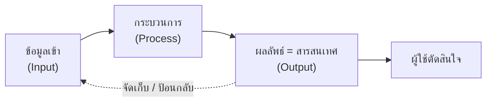
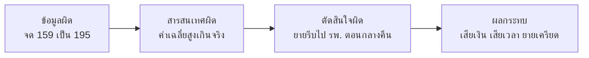

# ใบงานปฏิบัติการ (Worksheet)

**รหัสวิชา** GED2104 · **ชื่อวิชา** ชีวิตและเทคโนโลยีสารสนเทศสมัยใหม่ (Life and Modern Information Technology)

**ใบงานปฏิบัติการที่ 1:** ชีวิตฉันคือระบบสารสนเทศ — ตาราง “ข้อมูลเข้า → กระบวนการ → ผลลัพธ์” (IPO)

**เวลา** 120 นาที (คาบปฏิบัติ) · **ผลลัพธ์รายวิชา** CLO1 · **คะแนน** 10 คะแนน · **ทำเป็นรายบุคคล** (มีช่วงจับคู่)

| ชื่อ–นามสกุล | รหัสนักศึกษา | ชั้นปี/หมู่เรียน | คู่ของฉันคือ |
|---|---|---|---|
| &nbsp; | &nbsp; | &nbsp; | &nbsp; |

> **เงื่อนไขก่อนเริ่ม:** นี่คือใบงานแรกของรายวิชา ไม่ต้องมีพื้นฐานไอที ใช้แค่ปากกา กระดาษ และสมาร์ทโฟน
>
> **เก็บใบงานนี้ไว้** — ตาราง IPO ที่ทำวันนี้จะถูกใช้ต่อในใบงานที่ 2 (สัปดาห์ที่ 2) เมื่อเราเปลี่ยน “กระบวนการ” ให้เป็นดิจิทัล

---

## จุดประสงค์เชิงพฤติกรรม

เมื่อทำใบงานนี้เสร็จ นักศึกษาสามารถ

1. แยก “ข้อมูล” กับ “สารสนเทศ” ในกิจกรรมประจำวันของตนเองได้
2. เขียนตาราง IPO 6 ช่องของกิจกรรมประจำวันได้อย่างน้อย 3 กรณี (มีกรณีด้านสุขภาพอย่างน้อย 1 กรณี)
3. วิเคราะห์ว่าถ้าข้อมูลผิด จะกระทบการตัดสินใจอย่างไร โดยระบุคุณภาพสารสนเทศที่ขาดไป
4. ออกแบบวิธีหรือแบบบันทึกอย่างง่ายที่ช่วยป้องกันข้อมูลผิด
5. ใช้ AI ช่วยตรวจงานพร้อมตรวจสอบคำตอบของ AI และบันทึก AI Log ได้ถูกรูปแบบ

## ทฤษฎีย่อ (อ่าน 3 นาที)

**ข้อมูล (Data)** = ข้อเท็จจริงดิบ เช่น `38.4` · **สารสนเทศ (Information)** = ข้อมูลที่จัดและมีบริบทจนใช้ตัดสินใจได้ เช่น “ผู้ป่วยเตียง 5 อุณหภูมิ 38.4 °C เวลา 14.00 น. สูงขึ้นจากเช้า”



**IT มี 4 หน้าที่:** รวบรวม · ประมวลผล · จัดเก็บ · สื่อสาร

**คุณภาพสารสนเทศ 5 ด้าน:** ถูกต้อง · ทันเวลา · ครบถ้วน · ตรงประเด็น · ตรวจสอบได้ — ถ้าข้อมูลเข้าผิด ผลลัพธ์ก็ผิด (**GIGO**: Garbage In, Garbage Out)

## เครื่องมือและอุปกรณ์

| ลำดับ | รายการ | จำนวน |
|---:|---|---|
| 1 | กระดาษ A4 | 2 แผ่น/คน |
| 2 | ปากกา 2 สี | 1 ชุด/คน |
| 3 | สมาร์ทโฟนหรือคอมพิวเตอร์ที่เข้าอินเทอร์เน็ตได้ | 1 เครื่อง/คน |
| 4 | เครื่องมือ AI ที่เข้าถึงได้ (ChatGPT, Claude, Gemini, Copilot หรือที่อาจารย์กำหนด) | 1 บัญชี/คน หรือใช้ร่วมกับคู่ |
| 5 | สติกเกอร์จุดสำหรับโหวต | 2 ดวง/คน |

## ⚠️ ข้อควรระวัง

- **ห้ามใช้ข้อมูลส่วนตัวที่อ่อนไหว** เช่น เลขบัตรประชาชน รหัสผ่าน เลขบัญชี ผลตรวจสุขภาพจริงของตนเองหรือคนในครอบครัว — ให้ใช้ตัวเลขสมมติ
- ถ้ายกตัวอย่างคนในครอบครัว ให้เรียกว่า “คุณยาย A” “คุณพ่อ B” ไม่ระบุชื่อจริง
- **ห้ามใส่ข้อมูลบุคคลจริงลงในเครื่องมือ AI**

---

## 1. โจทย์กิจกรรม (The Challenge)

เขียนตาราง IPO ของ **กิจกรรมในชีวิตประจำวันของตนเอง 3 กิจกรรม** โดยต้องเป็น **กิจกรรมด้านสุขภาพอย่างน้อย 1 กิจกรรม** แล้วเลือก 1 กิจกรรมมาวิเคราะห์ว่า “ถ้าข้อมูลผิด จะเกิดอะไรขึ้น”

**ไอเดียกิจกรรม (ติ๊กที่เลือก หรือคิดเอง)**

- [ ] จ่ายเงินด้วยการสแกน QR
- [ ] เช็กชื่อเข้าเรียนผ่านลิงก์
- [ ] ดูตารางรถกลับบ้าน
- [ ] สั่งอาหารผ่านแอป
- [ ] นาฬิกา/แอปนับก้าว หรือบันทึกการนอน 🩺
- [ ] วัดความดันให้ผู้สูงอายุที่บ้านแล้วจดลงสมุด 🩺
- [ ] วัดสัญญาณชีพในห้องปฏิบัติการพยาบาลแล้วลงแบบบันทึก 🩺
- [ ] จองคิวโรงพยาบาลหรือคลินิก 🩺
- [ ] กิจกรรมอื่น: ______________________

### ตารางกำหนดเวลา

| ช่วง | กิจกรรม | เวลา | ใช้ AI? |
|---|---|---:|:---:|
| 0 | อ่านใบงาน เปิด GitHub รายวิชา จับคู่ | 10 นาที | ❌ |
| ขั้นที่ 1 | นับเทคโนโลยีใน 24 ชั่วโมงของฉัน | 15 นาที | ❌ |
| ขั้นที่ 2 | เขียนตาราง IPO 3 กรณี | 30 นาที | ❌ |
| ขั้นที่ 3 | ถ้าข้อมูลผิด…: วิเคราะห์และออกแบบวิธีป้องกัน | 20 นาที | ❌ |
| ขั้นที่ 4 | Prompt Lab: ให้ AI ตรวจงาน 3 รอบ + AI Log | 25 นาที | ✅ |
| ขั้นที่ 5 | แลกกันตรวจกับคู่ + โหวต + ส่งงาน | 20 นาที | ❌ |
| | **รวม** | **120 นาที** | |

---

## 2. ลำดับขั้นการปฏิบัติงาน

### ช่วงที่ 0 — เตรียมตัว (10 นาที)

1. เปิด GitHub ของรายวิชา `reru-subjects/life-and-next-gen-information-technology` บนมือถือ
2. หาแผนการเรียน 16 สัปดาห์ แล้วเขียนตอบ: สัปดาห์ไหนที่ฉันอยากเรียนที่สุด เพราะอะไร

   ……………………………………………………………………………………………………………
3. จับคู่กับเพื่อน 1 คน แล้วเขียนชื่อคู่ไว้ที่หัวใบงาน

### ขั้นที่ 1 — นับเทคโนโลยีใน 24 ชั่วโมงของฉัน (15 นาที) 🚫 ห้ามเปิด AI

นึกย้อนเมื่อวานตั้งแต่ตื่นจนนอน แล้วจดทุกครั้งที่ใช้เทคโนโลยี

| เวลา | ทำอะไร | ใช้เทคโนโลยีอะไร | มี “ข้อมูล” อะไรเกิดขึ้น |
|---|---|---|---|
| | | | |
| | | | |
| | | | |
| | | | |
| | | | |
| | | | |

**รวมทั้งวันฉันใช้เทคโนโลยี ______ ครั้ง** · กิจกรรมที่ขาดเทคโนโลยีไม่ได้เลยคือ ______________________

### ขั้นที่ 2 — เขียนตาราง IPO 3 กรณี (30 นาที) 🚫 ห้ามเปิด AI

เลือก 3 กิจกรรมจากขั้นที่ 1 (อย่างน้อย 1 กรณีเป็นด้านสุขภาพ 🩺) แล้วกรอกให้ครบ 6 ช่อง

**ตารางบันทึกที่ 1 — ตาราง IPO** *(หัวตารางตามใบความรู้รายวิชา)*

| กิจกรรม | ข้อมูลเข้า | วิธีประมวลผล | สารสนเทศ | ผู้ใช้ | ผลเมื่อข้อมูลผิด |
|---|---|---|---|---|---|
| ตัวอย่าง: ยายวัดความดันที่บ้าน | ค่าความดัน 3 ครั้ง/วัน 7 วัน | หลานใส่ตารางในมือถือ หาค่าเฉลี่ย ดูแนวโน้ม | ค่าเฉลี่ยรายสัปดาห์สูงขึ้นหรือไม่ | ยาย หลาน พยาบาล รพ.สต. | จดเลขสลับ (159 → 195) ทำให้ตกใจโดยไม่จำเป็น หรือจดต่ำกว่าจริงจนพลาดการพบแพทย์ |
| 1. | | | | | |
| 2. | | | | | |
| 3. 🩺 | | | | | |

**เช็กตัวเอง:** ช่อง “สารสนเทศ” ของฉันมีบริบท (ใคร / เมื่อไร / หน่วย) หรือยัง? ถ้ายังเป็นแค่ตัวเลขเปล่า ๆ แปลว่ายังเป็น “ข้อมูล” — กลับไปแก้

### ขั้นที่ 3 — ถ้าข้อมูลผิด…? (20 นาที) 🚫 ห้ามเปิด AI

เลือก 1 กรณีจากตารางที่ 1 (แนะนำกรณีสุขภาพ) แล้ววาด **ลูกโซ่ผลกระทบ** อย่างน้อย 3 ขั้น



**ตารางบันทึกที่ 2 — วิเคราะห์ข้อมูลผิด**

| หัวข้อ | คำตอบของฉัน |
|---|---|
| กรณีที่เลือก | |
| ข้อมูลผิดแบบไหน (ค่าผิด / ไม่มีหน่วย / บันทึกช้า / ขาดหาย / ไม่รู้ที่มา) | |
| คุณภาพสารสนเทศที่ขาด (ถูกต้อง / ทันเวลา / ครบถ้วน / ตรงประเด็น / ตรวจสอบได้) | |
| ลูกโซ่ผลกระทบ (อย่างน้อย 3 ขั้น) | |
| ใครได้รับผลกระทบบ้าง | |
| **วิธีป้องกัน 1 วิธีที่ทำได้จริง** | |

**ออกแบบ:** วาด **แบบบันทึกหรือขั้นตอนอย่างง่าย** ที่ช่วยป้องกันข้อมูลผิดในกรณีนี้ลงบนกระดาษ (เช่น สมุดบันทึกความดันที่มีช่องหน่วย เวลา ผู้วัด ตัวอักษรใหญ่ และช่อง “วัดซ้ำ”)

### ขั้นที่ 4 — Prompt Lab: ให้ AI ตรวจงาน 3 รอบ (25 นาที) ✅ ใช้ AI ได้

> **กติกาจริยธรรม:** ใช้เฉพาะข้อมูลสมมติ · AI เป็น “ผู้ตรวจ” ไม่ใช่ “ผู้ทำแทน” · ถ้า AI อ้างข้อเท็จจริงหรือตัวเลข ต้องตรวจกับเอกสารประกอบการสอนหรือแหล่งที่เชื่อถือได้ก่อนใช้

**รอบที่ 1 — ตรวจว่าแยกข้อมูลกับสารสนเทศถูกไหม**

```text
ฉันเป็นนักศึกษาพยาบาลปี 1 ไม่มีพื้นฐานไอที
นี่คือตาราง IPO ที่ฉันเขียน: [พิมพ์ 1 แถวจากตารางที่ 1]
ช่วยตรวจว่าช่อง "ข้อมูลเข้า" และ "สารสนเทศ" ของฉันแยกกันถูกต้องไหม
ถ้ายังไม่ถูก อธิบายด้วยภาษาง่ายไม่เกิน 100 คำ แต่อย่าเขียนตารางใหม่ให้
```

**รอบที่ 2 — หาผลกระทบที่ฉันมองข้าม**

```text
กรณีนี้: [กรณีจากตารางที่ 2] ข้อมูลผิดคือ [ลักษณะข้อมูลผิด]
ฉันคิดผลกระทบไว้ว่า [ลูกโซ่ของฉัน]
มีผลกระทบหรือผู้ได้รับผลกระทบอื่นที่ฉันยังไม่ได้คิดไหม บอกมา 2 ข้อ พร้อมเหตุผล
```

**รอบที่ 3 — ทดสอบวิธีป้องกัน**

```text
นี่คือวิธีป้องกันข้อมูลผิดที่ฉันออกแบบ: [อธิบายแบบบันทึก/ขั้นตอน]
ช่วยหาจุดอ่อน 2 ข้อ โดยคิดว่าผู้ใช้คือผู้สูงอายุที่สายตาไม่ดี
และเสนอวิธีปรับที่ไม่ต้องใช้เทคโนโลยีเพิ่ม
```

**AI Log (บันทึกการใช้ AI)** — รูปแบบนี้จะใช้ทุกใบงานตลอดภาคเรียน

| รอบ | เครื่องมือ AI | สรุปสิ่งที่ AI ตอบ (2–3 บรรทัด) | ตรวจกับอะไร | AI ถูก/ผิด/ไม่แน่ใจ | สิ่งที่ฉันเลือกแก้หรือไม่แก้ เพราะอะไร |
|:---:|---|---|---|:---:|---|
| 1 | | | | | |
| 2 | | | | | |
| 3 | | | | | |

**คำรับรอง:** ฉันใช้ AI ตามที่บันทึกไว้ข้างต้นเท่านั้น ไม่ได้ใส่ข้อมูลของบุคคลจริง และส่วนที่ไม่ได้ระบุว่ามาจาก AI เป็นความคิดของฉันเอง

ลงชื่อ: ______________________

### ขั้นที่ 5 — แลกกันตรวจ + โหวต (20 นาที)

1. **แลกใบงานกับคู่** (8 นาที) ตรวจตารางของเพื่อนด้วยคำถาม 3 ข้อ แล้วเขียนคำตอบลงช่องด้านล่าง

| คำถามตรวจงานเพื่อน | ✔/✘ | ข้อเสนอแนะ |
|---|:---:|---|
| ช่องสารสนเทศมีบริบท (ใคร/เมื่อไร/หน่วย) ครบทุกแถว | | |
| มีกรณีสุขภาพอย่างน้อย 1 กรณี | | |
| วิธีป้องกันข้อมูลผิดทำได้จริง | | |

ผู้ตรวจ: ______________________

2. **โหวต “ข้อมูลผิดที่น่ากลัวที่สุด”** (7 นาที) ติดตารางที่ 2 บนผนัง ทุกคนเดินอ่านและติดสติกเกอร์ 2 ดวง (ห้ามโหวตตนเอง)
3. อาจารย์สรุปกรณีที่ได้โหวตสูงสุด และเชื่อมไปสัปดาห์ที่ 2 (3 นาที)
4. ถ่ายภาพใบงานทุกหน้าและส่งก่อนออกจากห้อง (2 นาที)

---

## สรุปผลการปฏิบัติงาน

**สิ่งที่ฉันเข้าใจมากขึ้นเรื่อง “ข้อมูล” กับ “สารสนเทศ”**
……………………………………………………………………………………………………………
……………………………………………………………………………………………………………

**ในฐานะนักศึกษาพยาบาล ฉันจะบันทึกข้อมูลอย่างไรให้ถูกต้อง (1–2 ประโยค)**
……………………………………………………………………………………………………………

## ข้อเสนอแนะ

……………………………………………………………………………………………………………
……………………………………………………………………………………………………………

---

## 3. เงื่อนไขชิ้นงานที่ต้องส่ง (Deliverables)

ส่งในระบบที่อาจารย์กำหนด **ก่อนออกจากห้องเรียน** 1 ชุดต่อคน

- [ ] ตารางขั้นที่ 1 (เทคโนโลยีใน 24 ชั่วโมง)
- [ ] ตารางบันทึกที่ 1 — IPO 3 กรณี (มีกรณีสุขภาพ 🩺 อย่างน้อย 1 กรณี)
- [ ] ตารางบันทึกที่ 2 + ลูกโซ่ผลกระทบ + ภาพแบบบันทึก/ขั้นตอนป้องกันข้อมูลผิด
- [ ] AI Log 3 รอบ พร้อมคำรับรองที่ลงชื่อ
- [ ] ตารางตรวจงานโดยคู่

## 4. เกณฑ์การให้คะแนน (10 คะแนน)

| เกณฑ์ | รายละเอียด | คะแนน |
|---|---|---:|
| ตาราง IPO | ครบ 3 กรณี 6 ช่อง มีกรณีสุขภาพอย่างน้อย 1 กรณี | 3 |
| แยกข้อมูล/สารสนเทศ | ช่องสารสนเทศมีบริบทชัดเจนทุกแถว | 2 |
| วิเคราะห์ข้อมูลผิด | ลูกโซ่ผลกระทบ ≥ 3 ขั้น ระบุคุณภาพที่ขาดถูกต้อง | 2 |
| วิธีป้องกัน | ทำได้จริง มีแบบบันทึกหรือขั้นตอนประกอบ | 1 |
| AI Log และจริยธรรม | ครบ 3 รอบ ตรวจคำตอบ AI ไม่มีข้อมูลบุคคลจริง | 1 |
| การมีส่วนร่วม | ตรวจงานคู่และร่วมโหวต | 1 |
| **รวม** | | **10** |

> ใบงานนี้คิดคะแนนในหมวด “การบ้าน แบบฝึกหัด และงานมอบหมาย” (20% ตาม มคอ.3) · เกณฑ์ละเอียด (rubric 6 เกณฑ์ × 4 ระดับ) อยู่ในเอกสารประกอบการสอนสัปดาห์ที่ 1 ส่วนที่ 8
