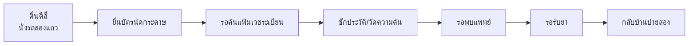

# ใบงานปฏิบัติการ (Worksheet)

**รหัสวิชา** GED2104 · **ชื่อวิชา** ชีวิตและเทคโนโลยีสารสนเทศสมัยใหม่ (Life and Modern Information Technology)

**ใบงานปฏิบัติการที่ 2:** แผนที่เส้นทางผู้ป่วย “ก่อน–หลัง” ดิจิทัล (Patient Journey Map)

**เวลา** 120 นาที (คาบปฏิบัติ) · **ผลลัพธ์รายวิชา** CLO1, CLO5 · **คะแนน** 10 คะแนน

| ชื่อ–นามสกุล | รหัสนักศึกษา | ชั้นปี/หมู่เรียน | กลุ่มที่ |
|---|---|---|---|
| &nbsp; | &nbsp; | &nbsp; | &nbsp; |

> **เงื่อนไขก่อนเริ่ม:** ใบงานนี้ต่อยอดจาก **ใบงานที่ 1** (ตาราง ข้อมูลเข้า → กระบวนการ → ผลลัพธ์) ให้เปิดตารางของตนเองไว้ข้างตัว วันนี้เราจะเปลี่ยน “กระบวนการ” ตรงกลางให้เป็นดิจิทัล แล้วดูว่าใครได้ประโยชน์และใครตกหล่น
>
> นักศึกษา **ไม่จำเป็นต้องมีพื้นฐานไอที** ใช้แค่ปากกา กระดาษ และสมาร์ทโฟน

---

## จุดประสงค์เชิงพฤติกรรม

เมื่อทำใบงานนี้เสร็จ นักศึกษาสามารถ

1. เขียนแผนภาพขั้นตอนบริการสุขภาพ **ก่อน** และ **หลัง** เปลี่ยนเป็นดิจิทัลได้ครบทุกขั้น
2. จำแนกแต่ละขั้นที่เปลี่ยนว่าเป็น Digitization, Digitalization หรือ Digital Transformation พร้อมเหตุผล
3. ระบุผู้ได้ประโยชน์และผู้ที่อาจเข้าถึงยาก โดยเชื่อมกับความเหลื่อมล้ำทางดิจิทัล 3 ระดับ
4. เสนอวิธีช่วยผู้เข้าถึงยากที่ทำได้จริงและเคารพความเป็นส่วนตัวของผู้ป่วย
5. ใช้ AI ช่วยตรวจงานพร้อมตรวจสอบคำตอบของ AI กับแหล่งข้อมูลทางการ และบันทึก AI Log ได้

## ทฤษฎีย่อ (อ่าน 3 นาที)

| ระดับ | เปลี่ยนอะไร | ตัวอย่าง |
|---|---|---|
| **Digitization** | รูปแบบข้อมูล (กระดาษ → ไฟล์) | สแกนบัตรนัดเก็บเป็น PDF |
| **Digitalization** | ขั้นตอนการทำงาน | จองคิวและดูคิวผ่านแอป |
| **Digital Transformation** | รูปแบบบริการทั้งระบบ | บัตรประชาชนใบเดียวรักษาได้หลายที่ ข้อมูลเชื่อมกันภายใต้ความยินยอม |

**ความเหลื่อมล้ำทางดิจิทัล 3 ระดับ:** ① ไม่มีอุปกรณ์/เน็ต (การเข้าถึง) ② มีแต่ใช้ไม่เป็น (ทักษะ) ③ ใช้ได้แต่ไม่ได้ประโยชน์หรือได้ข้อมูลผิด (ผลลัพธ์)

## เครื่องมือและอุปกรณ์

| ลำดับ | รายการ | จำนวน |
|---:|---|---|
| 1 | กระดาษ A4 หรือ A3 สำหรับวาดแผนภาพ | 2 แผ่น/กลุ่ม |
| 2 | ปากกาเมจิก 2 สี (สีหนึ่งใช้ “ก่อน” อีกสีใช้ “หลัง”) | 1 ชุด/กลุ่ม |
| 3 | กระดาษโน้ตกาว (Post-it) | 1 แพ็ก/กลุ่ม |
| 4 | สมาร์ทโฟนหรือคอมพิวเตอร์ที่เข้าอินเทอร์เน็ตได้ | อย่างน้อย 1 เครื่อง/กลุ่ม |
| 5 | เครื่องมือ AI ที่เข้าถึงได้ (ChatGPT, Claude, Gemini, Copilot หรือที่อาจารย์กำหนด) | 1 บัญชี/กลุ่ม |
| 6 | สติกเกอร์จุดสำหรับโหวต | 3 ดวง/คน |

## ⚠️ ข้อควรระวัง

- **ห้ามใช้ข้อมูลผู้ป่วยจริง** ชื่อจริง เลขบัตรประชาชน HN ผลตรวจ หรือภาพบุคคล ทั้งในกระดาษและใน AI — ให้ใช้ตัวละครสมมติเท่านั้น
- ถ้าเล่าประสบการณ์ของคนในครอบครัว ให้เรียกว่า “ผู้สูงอายุ A” ไม่ระบุชื่อ
- ข้อมูลนโยบาย (หมอพร้อม 30 บาทรักษาทุกที่ Health Link) ต้องตรวจจากเว็บไซต์ทางการ เช่น `moph.go.th` `nhso.go.th` ไม่ใช้คลิปหรือโพสต์ส่งต่อเป็นหลักฐาน

---

## 1. โจทย์กิจกรรม (The Challenge)

แต่ละกลุ่ม (4–5 คน) เลือก **บริการสุขภาพ 1 บริการ** และ **ผู้ใช้ 1 คน** แล้วสร้าง “แผนที่เส้นทางผู้ป่วย” ก่อนและหลังเปลี่ยนเป็นดิจิทัล

**เลือกบริการ (ติ๊ก 1 ข้อ)**

- [ ] นัดหมายและรอคิวตรวจที่โรงพยาบาลอำเภอ
- [ ] รับยาโรคเรื้อรัง (ความดัน/เบาหวาน) ทุก 2 เดือน
- [ ] ใช้สิทธิบัตรทองรักษาต่างจังหวัด (30 บาทรักษาทุกที่)
- [ ] ดูประวัติวัคซีน/ผลตรวจของตนเองในแอปหมอพร้อม
- [ ] อสม. คัดกรองสุขภาพผู้สูงอายุที่บ้าน (Smart อสม.)
- [ ] ปรึกษาแพทย์ทางวิดีโอ (Telemedicine) แล้วรับยาใกล้บ้าน
- [ ] บริการสุขภาพดิจิทัลอื่นในชุมชนที่กลุ่มสังเกตเห็นจริง: ______________________

**เลือกผู้ใช้ (ติ๊ก 1 ข้อ)**

- [ ] **ยายบุญมี** 72 ปี ความดัน+เบาหวาน ใช้โทรศัพท์ปุ่มกด อยู่กับหลานที่เป็นนักศึกษา
- [ ] **ลุงทองดี** 68 ปี มีสมาร์ทโฟน แต่สายตาไม่ดี อ่านตัวหนังสือเล็กไม่ได้
- [ ] **มะลิ** 24 ปี แรงงานข้ามชาติ อ่านภาษาไทยไม่คล่อง
- [ ] **แม่ปุ๋ย** 30 ปี ลูกอ่อน ไม่มีอินเทอร์เน็ตบ้าน ใช้เน็ตมือถือแบบเติมเงิน
- [ ] **น้องเจ** 19 ปี นักศึกษา ใช้แอปคล่อง (กลุ่มเปรียบเทียบ)

### ตารางกำหนดเวลา

| ช่วง | กิจกรรม | เวลา | ใช้ AI? |
|---|---|---:|:---:|
| 0 | อ่านใบงาน แบ่งกลุ่ม เลือกโจทย์ | 10 นาที | ❌ |
| ขั้นที่ 1 | วาดเส้นทาง “ก่อน” ดิจิทัล | 20 นาที | ❌ |
| ขั้นที่ 2 | วาดเส้นทาง “หลัง” ดิจิทัล + จำแนก 3D | 25 นาที | ❌ |
| ขั้นที่ 3 | หาจุดติดขัดและออกแบบวิธีรองรับ | 20 นาที | ❌ |
| ขั้นที่ 4 | Prompt Lab: ให้ AI ตรวจงาน 3 รอบ | 25 นาที | ✅ |
| ขั้นที่ 5 | Gallery Walk + โหวต + ส่งงาน | 20 นาที | ❌ |
| | **รวม** | **120 นาที** | |

---

## 2. ลำดับขั้นการปฏิบัติงาน

### ขั้นที่ 1 — วาดเส้นทาง “ก่อน” ดิจิทัล (20 นาที) 🚫 ห้ามเปิด AI

1. บนกระดาษแผ่นที่ 1 เขียนชื่อผู้ใช้ไว้มุมซ้ายบน
2. ใช้ปากกาสีที่ 1 เขียนขั้นตอนตั้งแต่ “เริ่มรู้ว่าต้องไปรับบริการ” จนถึง “กลับถึงบ้าน” ลงในกระดาษโน้ต **ขั้นละ 1 แผ่น** อย่างน้อย 6 ขั้น
3. เรียงกระดาษโน้ตจากซ้ายไปขวา ใต้แต่ละขั้นเขียน **เวลาที่ใช้โดยประมาณ** และ **ความรู้สึกของผู้ใช้** (😀 😐 😟)
4. วงกลมขั้นที่ “ใช้เวลานานที่สุด” หรือ “ทำให้ผู้ใช้ทุกข์ที่สุด”

ตัวอย่างโครง (ห้ามลอก ให้เป็นแนวทาง):



### ขั้นที่ 2 — วาดเส้นทาง “หลัง” ดิจิทัล และจำแนก 3D (25 นาที) 🚫 ห้ามเปิด AI

1. บนกระดาษแผ่นที่ 2 ใช้ปากกาสีที่ 2 วาดเส้นทางเดียวกันในแบบที่มีบริการดิจิทัลแล้ว
2. ขั้นที่เปลี่ยนไป ให้ติดป้ายกำกับ **D1** (Digitization) **D2** (Digitalization) หรือ **DT** (Digital Transformation)
3. ขั้นที่ถูก **ตัดทิ้ง** ให้ขีดฆ่าในแผ่นที่ 1 ขั้นที่ **เพิ่มขึ้นใหม่** (เช่น ติดตั้งแอป ยืนยันตัวตน รับ OTP) ให้ติดดาว ⭐
4. กรอกตารางบันทึกที่ 1

**ตารางบันทึกที่ 1 — เปรียบเทียบขั้นตอน** *(หัวตารางตามใบความรู้รายวิชา)*

| ผู้ใช้ | ขั้นตอนเดิม | ขั้นตอนใหม่ | ระดับ (D1/D2/DT) และเหตุผล | จุดติดขัด | วิธีรองรับ |
|---|---|---|---|---|---|
| | | | | | |
| | | | | | |
| | | | | | |
| | | | | | |
| | | | | | |

**เวลารวมโดยประมาณ** ก่อน: ______ ชั่วโมง · หลัง: ______ ชั่วโมง

### ขั้นที่ 3 — หาคนที่ตกหล่นและออกแบบวิธีรองรับ (20 นาที) 🚫 ห้ามเปิด AI

1. ดูขั้นที่มีดาว ⭐ ทุกขั้น แล้วถามว่า “ผู้ใช้ของเราทำขั้นนี้เองได้ไหม?”
2. กรอกตารางบันทึกที่ 2

**ตารางบันทึกที่ 2 — ผู้ได้ประโยชน์และผู้เข้าถึงยาก**

| | ใคร | เพราะอะไร | ความเหลื่อมล้ำระดับ (1/2/3) |
|---|---|---|:---:|
| ได้ประโยชน์มากที่สุด | | | – |
| ได้ประโยชน์รองลงมา | | | – |
| อาจเข้าถึงยาก คนที่ 1 | | | |
| อาจเข้าถึงยาก คนที่ 2 | | | |

3. ออกแบบ **วิธีรองรับ 1 วิธี** ที่ (ก) ทำได้จริงในชุมชน (ข) ไม่ต้องให้ผู้ป่วยบอกรหัสผ่านหรือ OTP กับคนนอก (ค) ไม่ยกเลิกช่องทางเดิม แล้ววาด **แผนภาพขั้นตอนใหม่** ที่ใส่วิธีรองรับนั้นแล้ว

> 💡 **ไอเดียเริ่มต้น:** อสม. หรือเจ้าหน้าที่ช่วยทำรายการ (Assisted Digital) · บัตรนัดพิมพ์ตัวใหญ่ควบคู่แอป · ญาติเป็นผู้รับแจ้งเตือนด้วยความยินยอม · ป้ายคำแนะนำภาษาอื่น · สอนแบบให้สาธิตกลับ (Teach-back)

**วิธีรองรับของกลุ่มเรา:** ______________________________________________

### ขั้นที่ 4 — Prompt Lab: ให้ AI ตรวจงาน 3 รอบ (25 นาที) ✅ ใช้ AI ได้

> **กติกาจริยธรรม:** ใช้เฉพาะตัวละครสมมติ · AI เป็น “ผู้ตรวจ” ไม่ใช่ “ผู้ทำแทน” · ทุกข้อที่ AI อ้างเรื่องนโยบายหรือตัวเลข **ต้องตรวจกับเว็บไซต์ทางการ** ก่อนใช้

**รอบที่ 1 — ตรวจการจำแนก 3D**

```text
ฉันเป็นนักศึกษาพยาบาลปี 1 ไม่มีพื้นฐานไอที
นี่คือขั้นตอนที่กลุ่มฉันจำแนกว่าเป็น Digitization / Digitalization / Digital Transformation:
[พิมพ์ขั้นตอนและระดับจากตารางบันทึกที่ 1]
ช่วยตรวจว่าจำแนกถูกไหม ถ้าไม่เห็นด้วย ให้อธิบายเหตุผลด้วยภาษาง่าย ตอบเป็นตาราง
```

**รอบที่ 2 — หาคนที่เรามองข้าม**

```text
ผู้ใช้ของเราคือ [ตัวละครสมมติ] และบริการคือ [ชื่อบริการ]
นอกจากที่เราคิดไว้ [รายชื่อจากตารางที่ 2] ยังมีกลุ่มคนใดอีกที่อาจเข้าถึงบริการนี้ยาก
บอกมา 3 กลุ่ม พร้อมเหตุผล และบอกว่าข้อมูลใดที่เราควรตรวจสอบเพิ่มจากแหล่งทางการ
```

**รอบที่ 3 — ทดสอบวิธีรองรับ**

```text
นี่คือวิธีรองรับที่กลุ่มเราออกแบบ: [วิธีรองรับ]
ช่วยหาจุดอ่อน 3 ข้อ โดยเฉพาะเรื่องความเป็นส่วนตัวของข้อมูลผู้ป่วย
และเสนอวิธีแก้ที่ทำได้ใน รพ.สต. หรือชุมชนชนบท
```

**AI Log (บันทึกการใช้ AI)**

| รอบ | เครื่องมือ AI | สรุปสิ่งที่ AI ตอบ (2–3 บรรทัด) | ข้อที่ตรวจกับแหล่งทางการ (ลิงก์) | AI ถูก/ผิด/ไม่แน่ใจ | สิ่งที่กลุ่มเลือกแก้หรือไม่แก้ เพราะอะไร |
|:---:|---|---|---|:---:|---|
| 1 | | | | | |
| 2 | | | | | |
| 3 | | | | | |

**คำรับรอง:** กลุ่มของเราใช้ AI ตามที่บันทึกไว้ข้างต้นเท่านั้น ไม่ได้ใส่ข้อมูลของบุคคลจริง และส่วนที่ไม่ได้ระบุว่ามาจาก AI เป็นความคิดของกลุ่มเราเอง

ลงชื่อสมาชิก: ____________ ____________ ____________ ____________ ____________

### ขั้นที่ 5 — Gallery Walk และโหวต (20 นาที)

1. ติดแผนภาพ “ก่อน” และ “หลัง” ของกลุ่มไว้บนผนัง (5 นาที)
2. เดินชมผลงานกลุ่มอื่น ติดสติกเกอร์โหวต 3 ดวงให้กลุ่มที่ **วิธีรองรับทำได้จริงที่สุด** (ห้ามโหวตกลุ่มตนเอง) และเขียนคำถามหรือข้อเสนอแนะบน Post-it อย่างน้อย 1 แผ่น (10 นาที)
3. อาจารย์ประกาศกลุ่มที่ได้โหวตสูงสุด ตัวแทนเล่า 1 นาที (3 นาที)
4. ถ่ายภาพแผนภาพทั้งสองแผ่นและส่งงานก่อนออกจากห้อง (2 นาที)

---

## สรุปผลการปฏิบัติงาน

**ข้อค้นพบที่ 1** (เกี่ยวกับการเปลี่ยนแปลงของขั้นตอนบริการ)
……………………………………………………………………………………………………………
……………………………………………………………………………………………………………

**ข้อค้นพบที่ 2** (เกี่ยวกับผู้ที่เข้าถึงยากและผลกระทบ)
……………………………………………………………………………………………………………
……………………………………………………………………………………………………………

**ในฐานะนักศึกษาพยาบาล เราจะช่วยผู้ใช้กลุ่มที่เข้าถึงยากได้อย่างไร (1–2 ประโยค)**
……………………………………………………………………………………………………………

## ข้อเสนอแนะ

……………………………………………………………………………………………………………
……………………………………………………………………………………………………………

---

## 3. เงื่อนไขชิ้นงานที่ต้องส่ง (Deliverables)

ส่งในระบบที่อาจารย์กำหนด **ก่อนออกจากห้องเรียน** 1 ชุดต่อกลุ่ม

- [ ] ภาพถ่ายแผนภาพเส้นทาง **ก่อน** และ **หลัง** ดิจิทัล (2 ภาพ ชัด อ่านได้)
- [ ] ภาพแผนภาพขั้นตอนใหม่ที่ใส่ **วิธีรองรับ** แล้ว
- [ ] ตารางบันทึกที่ 1 และ 2 ที่กรอกครบ
- [ ] ข้อค้นพบ 2 ข้อ และวิธีช่วยผู้เข้าถึงยาก
- [ ] AI Log 3 รอบ พร้อมลิงก์แหล่งตรวจสอบ และคำรับรองที่ลงชื่อครบ

## 4. เกณฑ์การให้คะแนน (10 คะแนน)

| เกณฑ์ | รายละเอียด | คะแนน |
|---|---|---:|
| แผนภาพก่อน–หลัง | ครบอย่างน้อย 6 ขั้น มีเวลาและความรู้สึกของผู้ใช้ อ่านง่าย | 2 |
| การจำแนก 3D | ป้าย D1/D2/DT ถูกต้องและมีเหตุผล | 2 |
| ผู้ได้ประโยชน์/ผู้เข้าถึงยาก | ระบุครบ และเชื่อมกับความเหลื่อมล้ำ 3 ระดับ | 2 |
| วิธีรองรับ | ทำได้จริง เคารพความเป็นส่วนตัว มีแผนภาพขั้นตอนใหม่ | 2 |
| AI Log และจริยธรรม | ครบ 3 รอบ ตรวจกับแหล่งทางการ ไม่มีข้อมูลบุคคลจริง | 1 |
| การมีส่วนร่วม | Gallery Walk โหวต และให้ข้อเสนอแนะกลุ่มอื่น | 1 |
| **รวม** | | **10** |

> ใบงานนี้คิดคะแนนในหมวด “การบ้าน แบบฝึกหัด และงานมอบหมาย” (20% ตาม มคอ.3) · เกณฑ์ละเอียด (rubric 6 เกณฑ์ × 4 ระดับ) อยู่ในเอกสารประกอบการสอนสัปดาห์ที่ 2 ส่วนที่ 8
